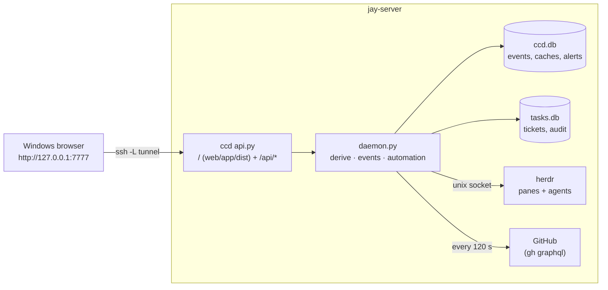

# Architecture (P2 daemon + P4B UI and task system)

```
            jay-server
 ┌───────────────────────────────────────────────────────────────┐
 │ herdr server ── owns every pane ── Claude coordinators, lanes │
 │      │ ~/.config/herdr/herdr.sock (unix, same user)           │
 │      ▼                                                        │
 │ ccd (systemd --user, own cgroup)                              │
 │   herdr.py   session.snapshot  bootstrap, every reconnect,    │
 │                                 every 30 s reconcile          │
 │              events.subscribe  push: agent status, structure  │
 │   sources.py gh api graphql   1 call / repo / 120 s           │
 │              git              unpushed + worktrees / 300 s    │
 │              /proc, docker ps host / 120 s; journalctl / 10 m │
 │   model.py   derive()         the legacy board logic, lifted  │
 │   daemon.py  diff → events → SQLite (seq) → WS subscribers    │
 │   tasks.py   tasks.db         tickets, audit (product data)   │
 │   api.py     127.0.0.1:7777   REST + WS + the built UI        │
 │      ▲                                                        │
 │ legacy board (Textual, cron ping) ── reads /api/state,        │
 │                                      local build if ccd down  │
 └──────┼────────────────────────────────────────────────────────┘
        └── ssh -N -L 7777:127.0.0.1:7777 jay-server ← Windows browser (P4B)
```

## herdr under systemd --user

herdr runs as `herdr.service` (`scripts/herdr.service`, installed and verified
2026-10-03) under the same user manager as ccd, with Linger=yes, so herdr and
every pane it owns survive SSH disconnects. Before that it ran in the
foreground of an SSH session and shut down when the session ended
(2026-10-02 23:41:59 CDT), killing every Claude pane.

The unit sets `PATH` explicitly. A `systemd --user` service inherits the user
manager's environment, not a login shell's: `/home/jay/.local/bin` reaches an
interactive shell through `~/.profile`, which the user manager never reads.
herdr spawns its panes as children of the service, so without the line every
pane inherited a `PATH` without `~/.local/bin` and `claude` was "command not
found" — the panes came up, but no Claude session could start in them.
`Environment=PATH=` puts `/home/jay/.local/bin` first for the server and every
pane. If herdr or claude moves, that line moves with it.

## herdr protocol notes (0.9.3, protocol 22, verified live)

- newline-delimited JSON over the unix socket; one response line per request
- `events.subscribe` holds its connection: `subscription_started`, then one
  line per event
- event names come in two spellings on one connection: structural events as
  `pane_created`, filtered subscription events as `pane.agent_status_changed`.
  ccd normalises both (a live bug found during the P2 canary)
- `pane.agent_status_changed` must name a `pane_id`, so the subscription is
  reopened whenever the set of agents changes
- events carry **no sequence number**: a dropped connection can lose events
  silently. ccd therefore resyncs from `session.snapshot` on every reconnect
  and every `reconcile_seconds`, and only trusts events for timeliness
- a protocol other than 22 → events ignored, snapshot polling only, warning in
  `/api/health`

## Source failure behaviour

| Source down | ccd |
|---|---|
| herdr | agents kept, state `unknown`, `herdr_error` set, alert raised, GitHub data still served; reconnect with backoff 1 → 30 s |
| GitHub | last-good data kept (also across restarts, from SQLite), per-project error + "as of" time; no false `pr.closed` events |
| git / host | last value kept, error in `sources` |
| ccd itself | clients reconnect with `?since=`; agents unaffected; legacy board builds locally |


## P4B: the browser UI



- **Same origin.** ccd serves `web/app/dist` at `/` with a strict CSP, so the UI
  and the API share `127.0.0.1:7777`: no CORS, no proxy, ccd's Host/Origin
  checks unchanged. Static files need no token (public code); every `/api/*`
  path except health still does.
- **Frontend layers** (`web/app/src`):

```text
screens/*          Overview, Projects, Agents, Tasks, PRs, Workspaces, Server, Activity, Alerts, Settings
   ↓ useSelector (lib/store.ts: external store, slice subscriptions, no library)
store/app.ts       one controller: REST bootstrap, live events, targeted refresh, never blanks
   ↓
api/client.ts      typed REST adapter (X-CCD-Token header, JSON writes)
api/live.ts        WS /api/events: token as subprotocol, replay from seq, events_lost → resync,
                   exponential backoff, 45 s silence watchdog
```

- **Data flow.** `GET /api/state` + `GET /api/tasks` + `GET /api/activity` on
  boot; then the WS stream from `state.seq`. A `task.*` event refetches just that
  ticket; any other event schedules one coalesced `/api/state` (≥1.5 s apart). A
  60 s refresh while visible picks up host numbers that change without events.
  Offline: data stays, the banner shows OFFLINE and the last update time; every
  source in the status line drops from `live` to `stale`.
- **Design system.** `styles/tokens.css` (dark first, light deliberate,
  `prefers-color-scheme` for "system", reduced-motion), `styles/app.css`. Sans
  for prose and titles, mono for keys, SHAs, branches, times, metrics, commands.
  No component library; React and react-dom are the only runtime dependencies.

## The project registry

`server/ccd/registry.py` is the one authoritative place a project's identity
lives: its display name, its ticket prefix, and any prefix it has retired.

| project | prefix | example | retired |
|---|---|---|---|
| SamVision | `SV` | SV-056 | – |
| GauzeMate | `GZ` | GZ-014 | `GM` |
| MyFamilyExpenses | `MFE` | MFE-008 | – |
| Command Center | `CC` | CC-012 | – |
| GYST / LifeOps | `GYST` | GYST-021 | – |

Everything reads it from there — `tasks.py` allocates keys, `config.py` fills
the board's project list, `model.py` strips and extracts IDs from PR and issue
titles, `daemon.py` validates a dispatch target, and the UI gets `prefix` per
project — so a prefix is never written down twice and can never disagree
between frontend, backend and migration code. A `prefix` in `config.json` may
repeat the registry but not contradict it; a contradiction is a startup error.

A project with no registry row and no explicit prefix can hold no tickets at
all, and says so instead of inventing a prefix from its directory name.

**Retiring a prefix** (GauzeMate GM → GZ, Jay's decision 2026-10-03):

- the keys already minted keep their prefix *and their numbers*: GM-014 stays
  GM-014, resolves, links to PRs, and appears in history
- the counter is per project, not per prefix, so the next GauzeMate ticket is
  `GZ-<next>`; no number is ever reused across the rename
- `task_project_aliases` records the retirement, and SQLite triggers enforce it:
  a prefix cannot change unless the old one is retired in the same transaction,
  a retired prefix cannot be deleted, moved or claimed by another project
- `GYST-VN-009`, `VN-073` and `OPS1` are *board IDs*, not ticket prefixes: they
  are recognised when reading INDEX.md and issue titles (`registry.BOARD_ID_PREFIXES`)
  and the importer keeps them as `legacy` ticket_links

## P4B: task system

Command Center's own tickets, so day-to-day work no longer lives in GitHub
Issues/Projects. See [ADR 0001](adr/0001-ticket-system-source-of-truth.md).

| table | holds |
|---|---|
| `task_projects` | project key → ticket prefix (SV, GZ, GYST, MFE, CC) and a forward-only counter |
| `task_project_aliases` | prefixes a project has retired (GauzeMate's GM). Resolved forever, never minted again |
| `tickets` | key, title, description, status, priority, type, assignee (`jay` / `role:X` / `agent:name`), agent pane/session, parent, branch, timestamps, four needs flags, archived, reserved `cycle_id` |
| `ticket_labels`, `ticket_relations` | labels; `blocks` / `related` / `duplicates` edges (`blocked_by` is the inverse view) |
| `ticket_comments` | human and agent notes |
| `ticket_links` | external records: `github pr owner/repo#94`, `legacy legacy_id VN-009`, URLs — the only place GitHub appears |
| `ticket_events` | the audit trail: one row per field change, with actor and trigger; append-only by trigger |

Rules enforced by SQLite triggers, not only code: tickets are never deleted
(archive), a key never changes, the counter never goes back, the audit trail is
append-only. Migrations are forward-only, one transaction each, `PRAGMA
user_version`; a newer file than the code refuses to open.

**Workflow.** `INBOX → PROPOSED → RESEARCHING → READY_TO_IMPLEMENT → IN_PROGRESS
→ IN_REVIEW → READY_TO_MERGE → VERIFYING → DONE`; off-pipeline `BLOCKED`,
`DENIED`, `CANCELLED`. Jay can set any status; automation only moves along these
deterministic triggers, each recorded as `system:automation` with its trigger:

| trigger | move |
|---|---|
| dispatch `plan` accepted by an idle coordinator | INBOX/PROPOSED → RESEARCHING |
| dispatch `implement` accepted | READY_TO_IMPLEMENT → IN_PROGRESS |
| open PR whose title or a branch segment **leads** with the key (same project) | link PR, set branch; READY_TO_IMPLEMENT/IN_PROGRESS → IN_REVIEW |
| linked PR approved, checks green, not draft | IN_REVIEW → READY_TO_MERGE |
| linked PR stops being ready | READY_TO_MERGE → IN_REVIEW |
| linked PR merged (found through `ticket_links`) | IN_REVIEW/READY_TO_MERGE → VERIFYING |

Never automatic: DONE (a verifier's or Jay's call), anything from a key merely
mentioned in a title, and re-applying a move Jay reversed by hand.

**Needs Jay.** `state.needs` = derived needs (merge-ready PRs, red main, My
actions, `needs:*` issue labels) + blocked agents (`state.blocked`) + every open
ticket with a needs flag. The UI orders it: blocked agents, merges, flagged
tickets, the rest.

**Agent integration.** `GET /api/tasks/{key}/context` returns the ticket and a
short brief (with the non-authorisation line) — what a coordinator needs for
"work CC-012". `POST /api/action/dispatch` accepts an existing ticket key for
samvision/gauzemate under the unchanged dispatch rules. Agents writing through
the API set `X-CCD-Actor: agent:<name>` (self-asserted; see SECURITY.md).

**GitHub decoupling.** Ticket never references a GitHub issue; PRs are
`ticket_links` rows `(provider, kind, ref)`. Another forge is a new provider
value plus its poller; the ticket tables do not change.

**Migration.** `GET /api/tasks/import-preview` (and Settings → Task migration
preview) reads INDEX.md tables, per-task files, cached issues, MY_ACTIONS.md and
handoffs, and reports would-create / would-update / ambiguous / duplicates /
skipped. It writes nothing. Existing IDs are kept (SV-056 stays SV-056); new keys
start after the highest ID any source used. Applying it is a separate,
Jay-approved step that is not implemented yet. GitHub issues are never closed or
edited by it.

## P4B: workspaces — browser mode vs Tauri mode

See [ADR 0002](adr/0002-workspaces-browser-and-tauri.md).

| | Browser mode (now) | Tauri mode (later) |
|---|---|---|
| layout | herdr's real workspaces → tabs → pane rectangles, from `session.snapshot` (`state.workspaces`) | same |
| focus | `POST /api/action/focus` with `agentId`, `workspaceId` or `tabId` (herdr `agent.focus`, `workspace.focus`, `tab.focus`) | same |
| output | READ-ONLY tail on demand (`/api/agents/{id}/tail`, redacted, never stored) | same |
| typing | only a one-line answer to a BLOCKED agent | a real terminal |
| interactive | copy `ssh -t jay-server herdr agent attach <name>` / `ssh -t jay-server herdr` into Windows Terminal | local PTY running that same ssh command, rendered in-app |
| layout changes | in herdr (Ctrl+B v / − / x …); ccd cannot split or close | in the embedded herdr session |

`web/app/src/workspace/transport.ts` is the seam: `WorkspaceTransport` with a
`BrowserTransport` today and `openTerminal()` reserved for Tauri. ccd never
carries the interactive byte stream in either mode.

## Dev instance

`scripts/dev-ccd.py` runs a second ccd on `127.0.0.1:7788` against a fake herdr
(real wire protocol), canned GitHub data and a seeded tasks.db, with state,
data and token in `~/command-center/dev/`. It never touches the live service.
