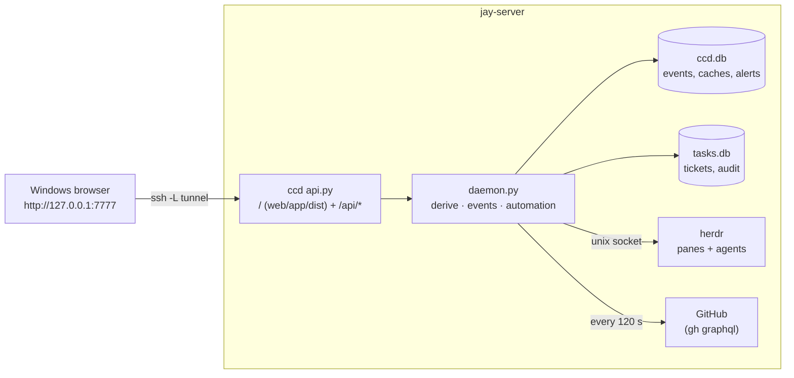

# Architecture (P2 daemon + P4B UI and task system)

```
            jay-server
 ┌───────────────────────────────────────────────────────────────┐
 │ herdr server ── owns every pane ── Claude coordinators, lanes │
 │      │ ~/.config/herdr/herdr.sock (unix, same user)           │
 │      ▼                                                        │
 │ ccd (systemd --user, own cgroup)                              │
 │   herdr.py   session.snapshot  bootstrap, every reconnect,    │
 │                                 every 30 s reconcile          │
 │              events.subscribe  push: agent status, structure  │
 │   sources.py gh api graphql   1 call / repo / 120 s           │
 │              git              unpushed + worktrees / 300 s    │
 │              /proc, docker ps host / 120 s; journalctl / 10 m │
 │   model.py   derive()         the legacy board logic, lifted  │
 │   daemon.py  diff → events → SQLite (seq) → WS subscribers    │
 │   tasks.py   tasks.db         tickets, audit (product data)   │
 │   api.py     127.0.0.1:7777   REST + WS + the built UI        │
 │      ▲                                                        │
 │ legacy board (Textual, cron ping) ── reads /api/state,        │
 │                                      local build if ccd down  │
 └──────┼────────────────────────────────────────────────────────┘
        └── ssh -N -L 7777:127.0.0.1:7777 jay-server ← Windows browser (P4B)
```

## herdr under systemd --user

herdr runs as `herdr.service` (`scripts/herdr.service`, installed and verified
2026-10-03) under the same user manager as ccd, with Linger=yes, so herdr and
every pane it owns survive SSH disconnects. Before that it ran in the
foreground of an SSH session and shut down when the session ended
(2026-10-02 23:41:59 CDT), killing every Claude pane.

The unit sets `PATH` explicitly. A `systemd --user` service inherits the user
manager's environment, not a login shell's: `/home/jay/.local/bin` reaches an
interactive shell through `~/.profile`, which the user manager never reads.
herdr spawns its panes as children of the service, so without the line every
pane inherited a `PATH` without `~/.local/bin` and `claude` was "command not
found" — the panes came up, but no Claude session could start in them.
`Environment=PATH=` puts `/home/jay/.local/bin` first for the server and every
pane. If herdr or claude moves, that line moves with it.

## herdr protocol notes (0.9.3, protocol 22, verified live)

- newline-delimited JSON over the unix socket; one response line per request
- `events.subscribe` holds its connection: `subscription_started`, then one
  line per event
- event names come in two spellings on one connection: structural events as
  `pane_created`, filtered subscription events as `pane.agent_status_changed`.
  ccd normalises both (a live bug found during the P2 canary)
- `pane.agent_status_changed` must name a `pane_id`, so the subscription is
  reopened whenever the set of agents changes
- events carry **no sequence number**: a dropped connection can lose events
  silently. ccd therefore resyncs from `session.snapshot` on every reconnect
  and every `reconcile_seconds`, and only trusts events for timeliness
- a protocol other than 22 → events ignored, snapshot polling only, warning in
  `/api/health`

## Source failure behaviour

| Source down | ccd |
|---|---|
| herdr | agents kept, state `unknown`, `herdr_error` set, alert raised, GitHub data still served; reconnect with backoff 1 → 30 s |
| GitHub | last-good data kept (also across restarts, from SQLite), per-project error + "as of" time; no false `pr.closed` events |
| git / host | last value kept, error in `sources` |
| ccd itself | clients reconnect with `?since=`; agents unaffected; legacy board builds locally |


## P4B: the browser UI



- **Same origin.** ccd serves `web/app/dist` at `/` with a strict CSP, so the UI
  and the API share `127.0.0.1:7777`: no CORS, no proxy, ccd's Host/Origin
  checks unchanged. Static files need no token (public code); every `/api/*`
  path except health still does.
- **Frontend layers** (`web/app/src`):

```text
screens/*          Overview, Projects, Tasks, Development, Console, Agents, Server, Activity, Alerts, Settings
   ↓ useSelector (lib/store.ts: external store, slice subscriptions, no library)
store/app.ts       one controller: REST bootstrap, live events, targeted refresh, never blanks
   ↓
api/client.ts      typed REST adapter (X-CCD-Token header, JSON writes)
api/live.ts        WS /api/events: token as subprotocol, replay from seq, events_lost → resync,
                   exponential backoff, 45 s silence watchdog
```

- **Data flow.** `GET /api/state` + `GET /api/tasks` + `GET /api/activity` on
  boot; then the WS stream from `state.seq`. A `task.*` event refetches just that
  ticket; any other event schedules one coalesced `/api/state` (≥1.5 s apart). A
  60 s refresh while visible picks up host numbers that change without events.
  Offline: data stays, the banner shows OFFLINE and the last update time; every
  source in the status line drops from `live` to `stale`.
- **Design system.** `styles/tokens.css` (dark first, light deliberate,
  `prefers-color-scheme` for "system", reduced-motion), `styles/app.css`. Sans
  for prose and titles, mono for keys, SHAs, branches, times, metrics, commands.
  No component library; React and react-dom are the only runtime dependencies.

## The project registry

`server/ccd/registry.py` is the one authoritative place a project's identity
lives: its display name, its ticket prefix, and any prefix it has retired.

| project | prefix | example | retired |
|---|---|---|---|
| SamVision | `SV` | SV-056 | – |
| GauzeMate | `GZ` | GZ-014 | `GM` |
| MyFamilyExpenses | `MFE` | MFE-008 | – |
| Command Center | `CC` | CC-012 | – |
| GYST / LifeOps | `GYST` | GYST-021 | – |

Everything reads it from there — `tasks.py` allocates keys, `config.py` fills
the board's project list, `model.py` strips and extracts IDs from PR and issue
titles, `daemon.py` validates a dispatch target, and the UI gets `prefix` per
project — so a prefix is never written down twice and can never disagree
between frontend, backend and migration code. A `prefix` in `config.json` may
repeat the registry but not contradict it; a contradiction is a startup error.

A project with no registry row and no explicit prefix can hold no tickets at
all, and says so instead of inventing a prefix from its directory name.

**Retiring a prefix** (GauzeMate GM → GZ, Jay's decision 2026-10-03):

- the keys already minted keep their prefix *and their numbers*: GM-014 stays
  GM-014, resolves, links to PRs, and appears in history
- the counter is per project, not per prefix, so the next GauzeMate ticket is
  `GZ-<next>`; no number is ever reused across the rename
- `task_project_aliases` records the retirement, and SQLite triggers enforce it:
  a prefix cannot change unless the old one is retired in the same transaction,
  a retired prefix cannot be deleted, moved or claimed by another project
- `GYST-VN-009`, `VN-073` and `OPS1` are *board IDs*, not ticket prefixes: they
  are recognised when reading INDEX.md and issue titles (`registry.BOARD_ID_PREFIXES`)
  and the importer keeps them as `legacy` ticket_links

## P4B: task system

Command Center's own tickets, so day-to-day work no longer lives in GitHub
Issues/Projects. See [ADR 0001](adr/0001-ticket-system-source-of-truth.md).

| table | holds |
|---|---|
| `task_projects` | project key → ticket prefix (SV, GZ, GYST, MFE, CC) and a forward-only counter |
| `task_project_aliases` | prefixes a project has retired (GauzeMate's GM). Resolved forever, never minted again |
| `tickets` | key, title, description, status, priority, type, assignee (`jay` / `role:X` / `agent:name`), agent pane/session, parent, branch, timestamps, four needs flags, archived, reserved `cycle_id` |
| `ticket_labels`, `ticket_relations` | labels; `blocks` / `related` / `duplicates` edges (`blocked_by` is the inverse view) |
| `ticket_comments` | human and agent notes |
| `ticket_links` | external records: `github pr owner/repo#94`, `legacy legacy_id VN-009`, URLs — the only place GitHub appears |
| `ticket_events` | the audit trail: one row per field change, with actor and trigger; append-only by trigger |

Rules enforced by SQLite triggers, not only code: tickets are never deleted
(archive), a key never changes, the counter never goes back, the audit trail is
append-only. Migrations are forward-only, one transaction each, `PRAGMA
user_version`; a newer file than the code refuses to open.

**Workflow.** `INBOX → PROPOSED → RESEARCHING → READY_TO_IMPLEMENT → IN_PROGRESS
→ IN_REVIEW → READY_TO_MERGE → VERIFYING → DONE`; off-pipeline `BLOCKED`,
`DENIED`, `CANCELLED`. Jay can set any status; automation only moves along these
deterministic triggers, each recorded as `system:automation` with its trigger:

| trigger | move |
|---|---|
| dispatch `plan` accepted by an idle coordinator | INBOX/PROPOSED → RESEARCHING |
| dispatch `implement` accepted | READY_TO_IMPLEMENT → IN_PROGRESS |
| open PR whose title or a branch segment **leads** with the key (same project) | link PR, set branch; READY_TO_IMPLEMENT/IN_PROGRESS → IN_REVIEW |
| pipeline ticket after `rework`: a PR or head that is neither the reviewed head nor an open PR recorded by the rework | IN_PROGRESS → IN_REVIEW (polls at known heads leave it IN_PROGRESS) |
| linked PR approved, checks green, not draft | IN_REVIEW → READY_TO_MERGE |
| linked PR stops being ready | READY_TO_MERGE → IN_REVIEW |
| linked PR merged (found through `ticket_links`), once per PR: not again after a reopen or rework | IN_REVIEW/READY_TO_MERGE → VERIFYING |

Never automatic: DONE (a verifier's or Jay's call), anything from a key merely
mentioned in a title, and re-applying a move Jay reversed by hand (a manual status edit; pipeline steps such as
`rework` always record a trigger and do not count as an override).

**Needs Jay.** `state.needs` = derived needs (merge-ready PRs, red main, My
actions, `needs:*` issue labels) + blocked agents (`state.blocked`) + every open
ticket with a needs flag. The UI orders it: blocked agents, merges, flagged
tickets, the rest.

**Agent integration.** `GET /api/tasks/{key}/context` returns the ticket and a
short brief (with the non-authorisation line) — what a coordinator needs for
"work CC-012". `POST /api/action/dispatch` accepts an existing ticket key for
samvision/gauzemate under the unchanged dispatch rules. Agents writing through
the API set `X-CCD-Actor: agent:<name>` (self-asserted; see SECURITY.md).

**GitHub decoupling.** Ticket never references a GitHub issue; PRs are
`ticket_links` rows `(provider, kind, ref)`. Another forge is a new provider
value plus its poller; the ticket tables do not change.

**Migration.** `GET /api/tasks/import-preview` (and Settings → Task migration
preview) reads INDEX.md tables, per-task files, cached issues, MY_ACTIONS.md and
handoffs, and reports would-create / would-update / ambiguous / duplicates /
skipped. It writes nothing. Existing IDs are kept (SV-056 stays SV-056); new keys
start after the highest ID any source used. GitHub issues are never closed or
edited by it.

**Running the import (CC-008).** Applying is a CLI step, never an HTTP route:

    cd server
    .venv/bin/python -m ccd.import_tasks --out report.json          # dry run (read-only)
    .venv/bin/python -m ccd.import_tasks --apply --out report.json  # after Jay approves the dry run

`--apply` first copies tasks.db with SQLite's backup API to
`<db>.bak-import-<UTC timestamp>` and prints that path. It then runs the same
preview and creates every would-create ticket, one transaction per project (an
error rolls that project back whole). DONE / DENIED / CANCELLED history is
created archived, so the default Tasks view stays clean; tick "Include
archived/history" to see it. Ambiguous items are reported, never guessed;
existing tickets are never edited (`pendingUpdates` counts what differs).

*Provenance and idempotency.* Each created ticket carries a
`legacy / import_source` link per source: `index:<file>#<ID>`,
`task_file:docs/tasks/<file>`, `github_issue:<owner/repo>#<n>`,
`my_actions:<project>:<sha1 of the normalised line, 12 chars>`. A source whose
link already exists is reported as `existing`, so a second `--apply` creates
nothing; a source added later gets the next free number. A MY_ACTIONS line with no ticket ID is identified by a hash of its text, so editing such a line and re-running the import creates a second ticket. Kept IDs (SV-056,
GM-014) never touch the counter's own numbers: it only moves past them.

*Worktree cleanup (CC-024).* The pipeline never deletes a worktree inside a step
(`release` only frees the writer). Instead the end of ccd's git poll
(`Daemon.poll_git_once` → `clean_worktrees`) asks `Pipeline.done_worktrees()` for DONE tickets
with a recorded worktree and hands them, with herdr's pane directories, to
`ccd/worktree_cleanup.py`, in a thread:

```
git poll ─▶ DONE tickets with a worktree ─▶ checks (path root, linked worktree + ticket branch,
            clean status, no commit missing from remotes, no herdr pane, no process in it)
         ─▶ all pass: git -C <repo> worktree remove <path>   (no --force, branch kept)
         ─▶ event task.pipeline  data.kind = pipeline.worktree_removed | pipeline.worktree_kept
```

A kept worktree is recorded once per reason (`git:wt_kept` in ccd.db's kv table, so a
restart does not repeat it). Config `worktree_cleanup` (default true) turns it off;
tests and `scripts/dev-ccd.py` set it false. No schema change, no API route.

## P4B revision: information architecture

Ten sections, in Jay's order. Pull requests live inside **Development** and the
herdr layout map inside **Console**; both keep their own routes, so old links
still work and nothing was deleted.

| section | answers |
|---|---|
| Overview | what needs Jay, what is being worked on, is anything broken, what changed |
| Projects | one project's cockpit |
| Tasks | the ticket system: table, pipeline, Needs Jay, inbox, detail |
| Development | ticket → branch → commits → PR → CI → review → merge → verify → deploy |
| Workspace | files, source control, search, editor; one terminal dock: Claude · Project · Server |
| Agents · Server · Activity · Alerts · Settings | unchanged |

The CI step in the Development row is `.github/workflows/ci.yml`: it runs the backend unittest suite and the web typecheck and tests on every pull request to `main` and on every push to `main` (it cannot be a required check on the free GitHub plan, so the reviewer reads its result).

**Overview** is deliberately four panels and nothing else: NEEDS JAY, ACTIVE
WORK, SYSTEM STATUS, RECENT ACTIVITY. No KPI strip, no pipeline widget, no
server meters — those belong to the sections that own them. Tickets in flight
with no agent on them collapse into one line rather than repeating Development.

**Development** (`GET /api/development`) associates a ticket with git work only
on evidence ccd can point at:

| evidence | counts |
|---|---|
| `ticket.branch` (set by hand, or from a linked PR's head branch) | yes |
| a local branch whose **leading segment** is the key (`SV-056-x`, `claude/SV-056`) | yes |
| a PR linked to the ticket (the automation links only a key that LEADS the title or branch) | yes |
| the key mentioned inside a branch name or in passing in a title | **no** |
| the key in a commit message | supporting only; it never creates an association |

Commit counts come from one `git log --format=%S --branches --not <default>`
per repo per `git_seconds` — one subprocess for every branch, not one each.
`deploy` is always `—`: ccd observes no deployments, and says so rather than
guessing.

## P4B revision: Console

> **Superseded (CC-016…019).** There is no Console screen, mirror or quick-console bar any
> more. The Workspace dock has three real browser terminals: **Claude** (herdr attach to the
> EXISTING coordinator, chosen by the one resolver `ccd/coordid.py`; an unnamed Claude at the
> root is offered for Adopt, never attached on cwd alone), **Project** (`repo:<PREFIX>`) and
> **Server**. Windows Terminal is an optional ⋯ action. The history below is kept for context.

See [ADR 0004](adr/0004-console-and-real-terminals.md) for the full design and
the herdr capability findings behind it.

| tab | what it is | lifetime |
|---|---|---|
| Claude | a READ-ONLY mirror of the project's coordinator pane, refreshed while visible; Jay can answer a blocked agent, as before | herdr's pane. Opening the browser never starts a session; closing it never ends one |
| Repo shell | a shell rooted in the project's repo — **not built**: shows the exact `ssh` command and why | a named ccd PTY session, once phase 3 ships |
| Server shell | a shell in `$HOME` — **not built**, same | same |

herdr has no output byte stream (`pane_output_changed` carries a revision, and
the client then calls `pane.read`) and no cols×rows control, so the Claude tab
is a mirror by nature. The two shells need a PTY service inside ccd; that is
the one change that would let anything holding the token run commands, so it
waits for Jay. The Quick Console at the bottom is now a launcher and a status
line, not a half-terminal.

## P4B: workspaces — browser mode vs Tauri mode

See [ADR 0002](adr/0002-workspaces-browser-and-tauri.md).

| | Browser mode (now) | Tauri mode (later) |
|---|---|---|
| layout | herdr's real workspaces → tabs → pane rectangles, from `session.snapshot` (`state.workspaces`) | same |
| focus | `POST /api/action/focus` with `agentId`, `workspaceId` or `tabId` (herdr `agent.focus`, `workspace.focus`, `tab.focus`) | same |
| output | READ-ONLY tail on demand (`/api/agents/{id}/tail`, redacted, never stored) | same |
| typing | only a one-line answer to a BLOCKED agent | a real terminal |
| interactive | copy `ssh -t jay-server herdr agent attach <name>` / `ssh -t jay-server herdr` into Windows Terminal | local PTY running that same ssh command, rendered in-app |
| layout changes | in herdr (Ctrl+B v / − / x …); ccd cannot split or close | in the embedded herdr session |

`web/app/src/workspace/transport.ts` is the seam: `WorkspaceTransport` with a
`BrowserTransport` today and `openTerminal()` reserved for Tauri. ccd never
carries the interactive byte stream in either mode.

## Dev instance

`scripts/dev-ccd.py` runs a second ccd on `127.0.0.1:7788` against a fake herdr
(real wire protocol), canned GitHub data and a seeded tasks.db, with state,
data and token in `~/command-center/dev/`. It never touches the live service.


## Control room (2026-10-07)

See [plans/COMMAND-CENTER-CONTROL-ROOM.md](../plans/COMMAND-CENTER-CONTROL-ROOM.md) (the approved spec, with the
implementation mapping at its end) and the references in `docs/design/`.

```text
Dashboard ─▶ Workspace ─▶ Task Room
 one panel     tree · dossier ·   Claude (task session sv-071) · Codex · Project (worktree) · Server
 per project   wall of ≤4 rooms   1–4 panes · pop out a pane or the room · same named session everywhere
```

| layer | where |
|---|---|
| visible stages, Needs Jay (gates + questions), merge acceptance, live-deploy gate, writer/checkpoint | `ccd/pipeline.py` |
| questions, evidence, writer, checkpoint, deploy, released | tasks.db schema 4 (`ticket_questions`, `ticket_evidence`, `ticket_work` columns) |
| answers → the SAME task session; nudges; closing releases sessions; records | `ccd/daemon.py` (`task_answers`, `task_work_op_async`, `on_task_closed`, `task_record`) |
| task session resolver (`sv-071`) | `ccd/coordid.py task_session`, used by ccd and `scripts/cc-terminal task <KEY>` |
| task terminals `repo\|claude\|codex:<KEY>` | `ccd/pty.py` (`session_cwd`, task resolver from the daemon) |
| readable records | `ccd/records.py` → `~/command-center/task-records/<project>/<KEY>/` |
| wall / rooms / panes / pop-out layout | `web/app/src/workspace/rooms.ts` (localStorage, shared by every window) |
| screens | `screens/Dashboard.tsx`, `screens/Workspace.tsx`, `screens/Popout.tsx`, `workspace/Room.tsx`, `workspace/Dossier.tsx`, `tickets/{Questions,GateCard}.tsx`, `components/Notifications.tsx`; the old IDE is `screens/Files.tsx` |

### Night shift, the supervisor and Go Live (CC-029, ADR 0006)

```text
Dashboard ☾ Night shift ─▶ POST /api/tasks/night-shift ─▶ coordinator pane gets skills/night-shift/SKILL.md
                                                       └▶ NightShift.start()  (.state.json, cutoffAt = next 07:00)
Daemon.night_loop (60 s) ─▶ night_tick ─▶ NightShift.decide(project, coordinator status, ticket activity)
      complete report / cutoff / 6 reminders / 3 quiet ─▶ shift ends (nothing typed)
      due ─▶ fresh read of the pane; idle ─▶ herdr prompt (fixed text) ─▶ NightShift.nudged()  (counted only now)
Dashboard Report ─▶ Go Live… ─▶ confirm box lists goLive.approves / warnings (GET /api/night-shift)
      ─▶ POST /api/jay/go-live ─▶ 409 guards ─▶ GO_LIVE_TEMPLATE to the idle coordinator (PREPARE, then wait)
                           ─▶ pipeline.confirm(deploy) per ticket (errors per ticket) ─▶ NightShift.went_live()
Jay confirms the deploy himself in the coordinator's pane. ccd never deploys.
```

`night_loop` is the seventh background loop of `Daemon.start` (beside herdr, github, git, host, derive,
housekeeping). Its state is `~/command-center/night-shift/.state.json` (atomic write; a restart resumes it) and the
morning reports are `~/command-center/night-shift/<project>/<YYYY-MM-DD>.md` (other `.md` files there are ignored), which `GET /api/night-shift` serves (64 KB each).
Only facts decide a tick: report status, the coordinator's herdr status, ticket changes in the project
(`Daemon._activity`) and the clock. With herdr down only "complete" and the cutoff can act. `pipeline.Pipeline.held`
(Jay-first rule) follows direct `blocks` relations only.

scripts/go-live.sh deploys origin/main only (CC-030); another branch needs `--branch <name> --i-know`, and `--dry-run` prints the target without changing anything.
### Auto-merge of reviewed low-risk PRs (CC-025, ADR 0007)

```text
Daemon.rederive ─▶ _ticket_automation (GitHub poll → ticket status, as before)
                └▶ await _auto_merge()      only if config auto_merge is true and no ~/command-center/state/auto-merge.stop
      for each registry project with merge "low-risk" and an allowlist (commandcenter):
        Pipeline.merge_candidates: READY_TO_MERGE, no gate, APPROVE recorded, nothing recorded for that head yet
          ─▶ gh pr view N --repo R --json …            (worker thread: the event loop never waits on gh)
          ─▶ merge_policy.classify(...)                (pure: paths, size, flags, review head, PR state, CI)
                ok   ─▶ stop file checked again ─▶ gh pr merge N --repo R --merge --match-head-commit <head>
                          ─▶ pipeline.auto_merged ─▶ GitHub poll sees the merge ─▶ pipeline.merged ─▶ VERIFYING
                no / gh failed ─▶ Pipeline.hold_merge: merge gate in Needs Jay with the reason (never retried)
                wait (CI running, mergeability unknown) / head moved ─▶ look again later, no gate
```

Pieces: `ccd/merge_policy.py` (allowlist, denylist, `classify`), `Pipeline.merge_candidates / hold_merge /
auto_merged`, `Daemon._auto_merge` and `gh_cli` (the injectable `gh` runner), registry `merge` values `owner` |
`low-risk`, `config.AUTO_MERGE_STOP`. While `auto_merge` is off a low-risk project behaves like `owner`
(`Pipeline.auto_merge`): the ready PR opens a merge gate. ccd never deploys; verify and deploy are unchanged.

### Desktop notice for new Needs Jay gates (CC-023)

```text
pipeline.gate_opened / pipeline.blocked ─▶ ticket_events (append-only)
ccd  Pipeline.gate_counts()  ─▶  GET /api/health  gates {open, last}   (no token, two integers)
launcher  gates.go  poll every 30 s (only while it holds the tunnel)
   first reading = silent baseline; `last` grew and open > 0 ─▶ notice
launcher  tray_windows.go  Shell_NotifyIconW NIF_INFO balloon ─▶ click = tray "Open Command Center"
```

The launcher holds no token (binary_test enforces it), so health is the only thing it can read. `gates.go` is
pure and tested on Linux (`ParseGates`, `gateWatch.Observe`, `app.watchGates`); `run.go` `waitForUser` now shows
the tray in Edge-window mode too, and Quit stops the tunnel. A second launcher or a reused tunnel polls nothing
and shows no icon. Items are named nowhere: names and click-to-ticket would need an in-page Notification.

Navigation is six items: Dashboard, Workspace, Task Manager, Activity / Logs, Files, Settings. Projects,
Development, Agents, Server, Alerts and Pull requests keep their routes and are under Settings → Diagnostics,
Activity / Logs and Ctrl+K.

Layout is per browser (every window of it); the work is not: rooms and panes are views of named ccd PTY
sessions and herdr panes, so moving a room between windows, popping out a pane or closing a window never
starts or stops a process. Concurrency limits are unchanged: 4 visible rooms per window is not 4 heavy
implementation lanes (`pipeline.MAX_LANES` still bounds IN_PROGRESS work).


## v2 Phase 1: Project Operating Profiles (policy/)

See [docs/COMMANDCENTER_V2_DISCOVERY.md](COMMANDCENTER_V2_DISCOVERY.md) §0, §7–§8 and [policy/README.md](../policy/README.md).

```text
policy/projects/<key>.toml ─┐
policy/decisions/D-NNN.toml ┼─▶ ccd/profiles.py load() at Daemon start (tomllib, never raises)
policy/examples/*.toml ─────┘      validate (strict schema) · SHA-256 per file · fingerprint · drift vs registry
                                   ├─▶ security event policy.loaded (fingerprint, problem count)
                                   ├─▶ alert policy:problems (broken file, missing profile, drift)
                                   └─▶ GET /api/profiles ─▶ Settings → Policies (read-only)
```

`[enforced]` restates what `ccd/registry.py` already makes ccd do (merge policy, night mode, pause, lanes, UI-test
fix mode); the registry still drives behaviour, and any disagreement is drift, an alert, and a failing test.
`[target]` holds Jay's decisions D-001 … D-009 as structured policy; nothing enforces it. The Autonomy Engine
reads it in shadow mode only. `policy/**` is in the auto-merge denylist (D-007).

### Autonomy Engine, shadow mode (ADR 0008)

```text
Pipeline step (plan / ready / auto-merge / deploy request) ─▶ Daemon._pipeline_result
   ├─▶ status changes + events, exactly as before (the registry and pipeline decide)
   └─▶ _shadow_record: autonomy.observed(events)   what ccd did      (auto | jay)
                       autonomy.evaluate(profile)   what [target] says (auto | jay | refuse) + rule, reasons, missing
                       ─▶ tasks.db autonomy_shadow (append-only, migration 6) ─▶ GET /api/autonomy ─▶ Settings → Policies
```

`evaluate` is pure and conservative: an invalid profile, an unknown fact (risk, changed files, UI/API impact) or a
human-only boundary is "jay", never "auto"; a paused project is "refuse"; protected paths (D-007) and personal-data
paths (D-005) are "jay". Nothing reads the verdict to act, and a failure in it is a log line.

### Decision and Approval records (PR 4)

```text
Daemon start ─▶ ledger.seed_policy(policy/decisions)  Jay's D-NNN as Decision rows (idempotent; a change supersedes)
             └▶ ledger.reconcile(tickets with an open gate or approval)   the same reconcile as below
Pipeline step ─▶ _pipeline_result ─▶ ledger.observe(events, work after the step)
    gate_confirmed (event)  → approved by Jay, with how (ui / go-live / gate); plan / ui / failure: consumed at once
    then reconcile against the state the step left:
      an open gate with no open approval → pending, bound to its subject hash
                                           (merge: reviewed head; plan: plan hash; deploy: request hash)
      pending, but the gate closed or its subject changed → void
      approved merge: merged since → consumed if `merge:<head>` still covers the merged head, else void;
                      not merged and no longer covered (new head, rework, re-plan) → void
      approved deploy: a LIVE deployment happened since (pass or fail) → consumed; request withdrawn → void
      the ticket closed or was archived → void
    answered → each answered question becomes a Decision
```

`tasks.db` v7 enforces the rules in the schema: decisions are append-only; an approval's subject never changes, it
only moves forward (pending → approved → consumed, or → void / rejected), only `jay` can be its approver, who and how
is written once, at most one is open per ticket and gate, and none is ever deleted. `expires_at` (72 h) is recorded;
nothing enforces it yet. The gates in `ticket_work` remain the source of truth; the ledger is their record, and a
failure in it is a log line. GET /api/decisions, Settings → Decisions (read-only).

### Worker nodes (PR 5)

The model and enrolment only; jobs, leases and the reaper are Phase 2, and today's agents still run in the server's
herdr panes. At start ccd registers its own host as the `server` node (tools on PATH, registered repos checked out)
and heartbeats it from the derive loop every 30 s. Another machine enrols with ccd's token
(`POST /api/workers/enrol`), receives a node token once (ccd keeps the SHA-256), stays `pending` until Jay approves it
with Developer Unlock, then heartbeats with `X-CCD-Node: <id> <token>`. Revoking is final. tasks.db v8 enforces it:
nodes are never deleted, `active` needs `approved_by = 'jay'`, revoked is final, a node's id, kind and token never
change, and the event log is append-only; ccd writes each status change and its `worker_events` row in one
transaction (heartbeats are not events). An agent cannot enrol a node (by its stated actor; since PR 7 an actor token can
verify that statement, but it is recorded, not yet required); each node has a fingerprint Jay matches before approving. Settings → Workers.

### Needs You v2 (PR 6)

One inbox over everything that waits on Jay (sidebar → Needs You, key `0`). The queue is unchanged: it is still
`state.needs` plus blocked agents, assembled by the same `jayQueue` the dashboard and the bell use, so the three
never disagree. `ccd/inbox.py` adds, read-only, per item (GET /api/inbox, keyed `kind:project:ref`): the pending
Approval for a gate (subject hash, expiry, overdue), the shadow engine's newest verdict for that gate, and for open
questions earlier answered questions with the same wording, kind and options in the same project (at least three
meaningful words; task-check proposals never count; shown, never applied). Items are grouped by project or by type,
overdue first (groups too); each card has one action, which opens the place Jay acts today. A gate hidden behind its
ticket's open questions carries its approval on the questions card. Pending approvals with no item in the queue are
listed as a consistency check. The page re-reads the details every minute. A failure in the
overlay leaves the list complete. Approving several at once waits for the engine to leave shadow mode.

### Audit trail, actor identity, metering (PR 7)

tasks.db v9 adds `audit_events`, `actor_tokens`, `usage_records` and `usage_cursor`, all append-only except the
cursor and a token's one revoke. `api.AuditTrail` sits between `Guard` and the routes: after every write it calls
`Daemon.audit_write`, which works out how far the claimed actor is proven (`identity.identify`: Developer Unlock for
Jay, an actor token for an agent, otherwise unverified) and appends a hash-chained row (`audit.Audit`). Handlers
hand it the parsed body and claimed actor through a context variable; only the body's hash and key names are kept.
`_pipeline_result` appends each pipeline event as `system:ccd`. Nothing reads the trail to decide anything.
`Daemon.meter_loop` runs `meter.Meter` every 5 minutes in three steps so the shared tasks.db connection is only
used on the event loop: `plan()` (cursors) → `read()` in a thread (log files only) → `store()`. Attribution: a
ticket's recorded worktree, else a ticket key in the branch or directory name, else the project by path.
Settings → Audit (trail, chain check, what enforcing identity would refuse, actor tokens) and Settings → Usage
(tokens and estimated cost by project, model, day and ticket; budgets shown, not enforced).
